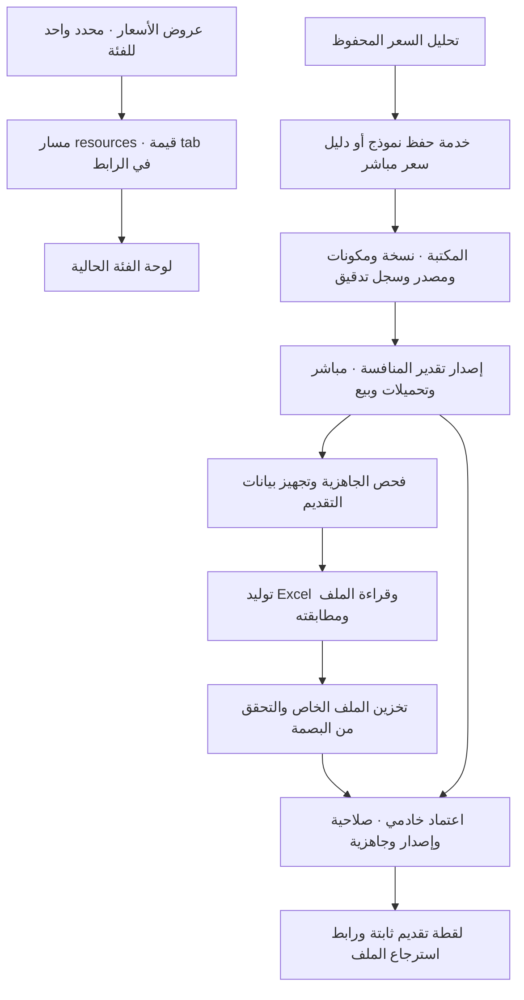

# تقديري | خطة اعتماد العطاء وحفظ المكتبة وتبسيط عروض الأسعار

هذه حزمة تنفيذ لملاحظات التحقق على V3. الأولوية التشغيلية هي أن يعتمد مدير العطاء ملفاً يمكن استرجاعه، وأن يطابق الملف واللقطة حساب إصدار التقدير نفسه. يمكن تسليم القائمة المنسدلة مستقلةً بالتوازي. تعتمد الخطة على TanStack Start وعملاء Supabase الحاليين، مع ترحيلات SQL مراجعة وصلاحيات تُفرض على الخادم وقاعدة البيانات.

## المعمارية المقترحة

## 1. اعتماد إصدار التقدير وملف التقديم

**العقد.** يرسل التطبيق معرّفات المشروع والمنافسة وإصدار التقدير وفحص الجاهزية وملف التجهيز، مع مفتاح إعادة المحاولة. يحدد الخادم هوية المستخدم، ويتحقق من صلاحية الاعتماد ونطاق المعرفات. يُشتق رقم إصدار التقدير وبصمة مدخلاته من الحالة المخزنة فعلياً. تشمل البصمة مراجعة المقايسة والسطور والكميات والموارد والتحميلات وسياسة التقريب وأثر التعليقات والقرارات المؤثرة في الجاهزية. استدعاء الاعتماد الحالي في `src/routes/_authenticated/tender-assurance.tsx` يستخدم رقم الإصدار 1 ويقارن مصفوفة التصدير بنفسها. تُستبدل هذه المدخلات بطلب مرتبط بإصدار محفوظ.

1. **التجهيز.** يقرأ الخادم بيانات الإصدار ويحسب جدول التقديم من مدخلاته الفعلية. يُنشأ مصنف التقديم حسب القالب المعتمد للمنافسة. عند اشتراط مصنف المالك يُستخدم مسار الكتابة إلى الأصل في `src/lib/excel-roundtrip.ts` وخريطة أوراقه وخلاياه. تُحفظ بيانات التجهيز باسم الإصدار ومعرفه.
2. **المطابقة.** يُعاد فتح بايتات المصنف التي ستُرفع. تُقارن هوية كل بند وموضعه عند الحاجة، والوحدة والكمية وسعر الوحدة والإجمالي، ثم المجاميع المطلوبة قبل الضريبة وبعدها حسب قواعد الملف. يُكشف السطر الناقص والمكرر وتغيير قيمة خلية. يُحسب SHA-256 للبايتات المتحقّق منها.
3. **التخزين.** يُحفظ الملف في مساحة خاصة بمسار فريد للتجهيز، ويثبت الخادم وجود الملف وأن بصمته مطابقة. يخزن سجل التجهيز المسار والبصمة والحجم ومعرف الإصدار. فشل الرفع أو القراءة يعيد حالة قابلة للمحاولة ويوقف القفل. رابط التنزيل بعد الاعتماد يقرأ نفس البايتات المحفوظة.
4. **القفل.** في معاملة قاعدة بيانات يثبت مسار الاعتماد أن الإصدار ما زال صالحاً وأن فحص الجاهزية والملف يخصانه. تُقفل النسخة أو تُحمى بمراجعة متزامنة تشمل الكتابات التابعة، ثم تحفظ اللقطة والإجماليات ومسار الملف وبصمته والقرارات وسجل الانتقال معاً. تعيد المحاولة بنفس المفتاح اللقطة نفسها، ويعاد التجهيز عند تغير أي مدخل مؤثر. تظل ملفات التجهيز منفصلة عن الملفات المعتمدة حتى تكتمل المعاملة.

**نقاط الدمج.** يوحّد الفريق استدعاء الاعتماد من شاشة الجاهزية ومن `financial.tsx` عبر `client-tender-service.ts`. يحدد الترحيل الجديد توقيع RPC المعتمد، ويفحص التوقيعات السابقة ويتأكد من خضوع جميع الاستدعاءات المسموح بها لنفس شروط القفل. يقتصر تثبيت حالة التقديم على هذا المسار وفق صلاحيات RLS والمنح. يشغّل تجهيز المصنف معالجاً خادمياً متوافقاً مع الاستضافة القائمة. يُتحقق من ذلك في بيئة اختبار قبل ربط الواجهة.

## 2. التكلفة المباشرة وحساب البيع

- يحدد `estimation-calc.ts` قواعد تسعير قابلة للمقارنة مع إعادة الحساب الخادمية. يشترك المساران في حالات اختبار رقمية تشمل المواد والهالك، وإنتاجية العمالة والمعدات، ومقاول الباطن، وحذف آخر مورد، والبند المشمول، والسعر اليدوي والكميات الكسرية. توثق سياسة الدقة والتقريب في إصدار التقدير وتُطبّق على الشاشة وExcel واللقطة.
- يحسب المسار الخادمي المباشر من الموارد أو أساس تكلفة معتمد، ويطبّق نسب العطاء على المباشر ثم يقرّب بيع الوحدة لأعلى. يُعامل تجاوز البيع اليدوي كتجاوز للبيع. إذا كانت التكلفة المباشرة 4 ريالات والبيع اليدوي 6.25 والكمية 2.5، يكون المباشر الممتد **10.00**، وبيع الوحدة **7**، وإجمالي البيع **17.50**.
- يستخدم الخادم نتيجة حسابه لسطور اللقطة وإجمالياتها. تدخل حالة المقايسة الفارغة أو البند الإلزامي غير المسعّر في نتيجة الجاهزية وفق سياسة المنافسة. تمرّ الأسعار المستوردة مجهولة الأساس عبر المراجعة قبل اعتمادها كتكلفة مباشرة. تحافظ كل مكتبة على تكلفة الشراء أو المباشر الأصلي، ويقرأ الاستدعاء تحميلات العطاء المستهدف.

## 3. حفظ نموذج المكتبة ودليل السعر

تنقل `knowledge-library-service.ts` الحفظ إلى عملية خادمية تقرأ إصدار التحليل المحفوظ، وتتحقق من نطاقه ومن صلاحية فاعل الحفظ. يرسل المستخدم معرفات سطور الموارد عند إضافة دليل سعر. يبني الخادم التكلفة والمصدر من السجلات المحفوظة. تُكتب هوية النموذج وإصداره ومكوناته ومصدره وسجل التدقيق في معاملة واحدة، وتطبق قاعدة منع التكرار على طلب الحفظ. يطبق النشر أو الاعتماد صلاحياته على الخادم. تقرأ المكتبة السجلات المحفوظة من قاعدة البيانات، وتظهر الواجهة رسالة نجاح بعد تأكيدها. عند رفض أي كتابة تعيد الواجهة السبب وتتيح إعادة المحاولة. يستخدم النسخ والتعديل والاستيراد نفس قواعد التكلفة المباشرة والإصدارات.

**قبول هندسي.** يحفظ المسعّر نموذجاً من مشروع ثم يفتحه من جلسة ثانية ويطابق الرقم والإصدار والمصدر. يكرر الطلب بعد انقطاع الاتصال فيحصل على نفس السجل. يُختبر فشل كتابة الإصدار والتدقيق، وحفظ حساب بلا صلاحية، والتعديل المتزامن، ويُتحقق من النتيجة المخزنة بعد كل حالة.

## 4. القائمة المنسدلة داخل عروض الأسعار

يستبدل محدد **«عرض الفئة»** صف التبويبات العشرة المرفق. يظهر اسم العرض الحالي في زر واحد بجوار البحث ومرشح CSI. عند الفتح يرى المستخدم القائمة التالية، ويظهر المختار بعلامة اختيار. نفس المحدد يعمل على سطح المكتب والجوال.

| المجموعة داخل القائمة | الخيارات |
|---|---|
| عام | عام (الكل) |
| طرق عرض الأسعار | عروض الموردين الفعلية، الأسعار المرجعية (من تحليل)، عروض حسب المشروع، عروض النماذج النمطية |
| فئات الموارد | المواد، العمالة، المعدات، مقاولو الباطن، المتطلبات العامة للمشروع |

- يُعاد استخدام مكوّن `Select` الحالي داخل `resources.tsx` بما فيه تسمية مقروءة لقارئ الشاشة، والتنقل بالأسهم وEnter والإغلاق بـEsc. تدعم القائمة العربية RTL والإنجليزية LTR، وتتمدد ضمن عرض الشاشة الصغيرة مع تمرير داخلي للقائمة عند الحاجة.
- تعتمد الصفحة قيمة `tab` في عنوان الرابط لتحديد العرض. يكتب المحدد القيمة نفسها التي تستخدمها روابط الشريط الجانبي الحالية في `app-shell.tsx`. القيمة الافتراضية هي `all` عند فتح الصفحة العامة أو عند قيمة غير صالحة. يُختبر تحديث الصفحة ورجوع المتصفح وفتح الرابط مباشرة. تُحفظ مفاتيح الخيارات الحالية.
- يبقى محتوى كل عرض وإجراء «إضافة مورد» وفلاتر الصفحة مربوطاً بالفئة المختارة. يحدد اختبار القبول سلوك البحث ومرشح CSI عند الانتقال، مع الاحتفاظ بهما حيث ينطبقان. يُستخدم مسار منع فقد التعديلات القائم إذا كان تغيير الفئة سيغلق نموذجاً قيد التحرير.
- يُعرض العداد حيث يوجد مصدر مطابق لعدد سجلات العرض. عروض الموردين والأدلة المرجعية وطرق العرض حسب المشروع تُقرأ من بياناتها الفعلية إذا تقرر إظهار عددها. تعرض اختبارات الواجهة الحالات الفارغة وغير الفارغة بعينة تشمل عرضاً حقيقياً ومرجعاً داخلياً.

## ترتيب التنفيذ والقبول

### عقود التنفيذ ومسؤولية كل قرار

| العملية المقترحة | المدخل المعتمد | نتيجة العملية عند النجاح أو التعارض |
|---|---|---|
| حفظ نموذج أو نشر أسعار موارد | هوية المستخدم من الجلسة، وإصدار التحليل، ومعرّفات السطور والوجهة | يعيد الخادم معرّف النموذج وإصداره أو معرّفات الأدلة المحفوظة. يرفض المصدر الذي تعدّل منذ المعاينة ويعيد رقم الإصدار الحالي. يعرض المسعّر الفروق قبل إعادة الطلب |
| تجهيز العطاء | نسخة التقدير ومراجعة المقايسة المعتمدة وشكل المصنف المطلوب | يسجل الخادم معرّف تجهيز مرتبطاً بالإصدار، وبصمة المدخلات، ونتيجة قراءة الملف، ومفتاح التخزين وبصمة البايتات. تستخدم الشاشة نفس معرّف التجهيز في الاعتماد |
| اعتماد التقديم | معرّف التجهيز ونتيجة الجاهزية ومفتاح إعادة المحاولة | تُقرأ صلاحية المعتمد من عضويته الفعلية. يعيد الخادم رقم التقديم إذا نجح، أو سبب التوقف والبند أو الإصدار المتأثر. تكرار مفتاح الطلب مع محتوى مختلف يعيد تعارضاً |
| استرجاع التسليم | معرّف التقديم والصلاحية على المنافسة | تُقرأ بيانات اللقطة ومسار الملف من السجل المعتمد، ويُصدر رابط تنزيل محدود الصلاحية للملف المخزن. يطابق اختبار الاسترجاع البصمة المسجلة بعد تنزيله من جلسة أخرى |

**حالات الاعتماد.** تظل نسخة التقدير قابلة للتحرير أثناء التجهيز. إذا سبق تعديل السعر عملية القفل، يكتشف الخادم تغيّر النسخة ويرد بطلب إعادة الفحص. وإذا سبق القفل عملية التعديل، تُوجّه الكتابة اللاحقة إلى مسودة جديدة. عند فشل التثبيت بعد رفع الملف، يحتفظ التجهيز بمرجع الملف لإعادة المحاولة. يُنظّف الملف المتروك بعد التحقق من عدم ارتباطه بلقطة أو طلب جارٍ.

**ملكية الحساب.** يعتمد رئيس التسعير عينة مرجعية تشمل بنداً مقطوعاً، وكمية كسرية، وسعراً يدوياً، وبنداً مشمولاً في غيره، ومورد حديد بوحدة طن يُستهلك بالكيلوغرام، وعرض خرسانة يشمل الضخ. لكل حالة يسجل أساس القياس والمباشر وسعر البيع قبل التقريب وبعده وإجمالي البند. تُشغّل العينة نفسها على المحرك والـSQL والملف الناتج. يُعرّف الصفر المعتمد والبند غير المسعّر والخلية الفارغة كحالات مستقلة حتى يُفسر فرق الملف تفسيراً صحيحاً.

**اختبار مصنف المالك.** يراجع مهندس الحصر مصنفاً متعدد الأوراق به أرقام بنود مكررة في أقسام مختلفة ورؤوس مدمجة. تحدد خريطة المراجعة الورقة والصف وخلايا الإخراج لكل بند. يُفحص ترتيب الأوراق وصيغ الإجماليات وخلايا الأسعار بعد حفظ الملف. إذا اعتمدت قيمة إجمالي على صيغة، تُختبر إعادة حسابها بأداة متوافقة مع المصنف وتُقارن مع إجمالي السطور. يوضح تقرير الاختلاف اسم الورقة وعنوان الخلية والقيمة المتوقعة والفعلية حتى يستطيع المهندس إصلاحها.

### الانتقال من الإصدار الحالي

1. **خط الأساس.** يسجل مسؤول الإصدار الالتزام المرشح ووجهة Supabase وسجل الترحيلات الفعلي. يتحقق على بيئة الاختبار من تواقيع دالة التقديم المتاحة بعد الترحيلين 004 و006، ومن المسار الذي تستخدمه شاشتا المالية والجاهزية. اختلاف عدد معاملات الدالة يستلزم فحص التوقيع والصلاحيات في القاعدة.
2. **التوسعة والاختبار.** تضاف قيود الإصدار وروابط ملف التجهيز وقواعد منع التكرار بترحيل جديد. تُحفظ اللقطات القديمة بعلامة توضّح مدى توافر دليل الملف الأصلي. يتأكد الفريق من قابلية استرجاع عينة قديمة قبل تحويل مسار الكتابة.
3. **التحويل.** تُجرّب القائمة المنسدلة مستقلة، ثم يُفعّل مسار الحفظ والاعتماد على منافسة تجريبية لها نسختان من المقايسة. يتولى مهندس التسعير مطابقة الأرقام، ومسؤول البيانات اختبار العزل، ومدير العطاء توقيع ملف التسليم. يتضمن محضر التجربة رقم الإصدار ومعرّف الفحص وبصمة الملف ونتيجة تنزيله.
4. **التراجع.** إذا فشلت المطابقة، يُوقف اعتماد تقديمات جديدة للميزة المتأثرة وتبقى المسودات متاحة للعمل. يسترجع الفريق آخر إصدار متوافق جُرّب مع المخطط، ويصالح الطلبات المعلقة بمفاتيحها. يُعاد فتح الاعتماد بعد نجاح تجربة الملف والحساب على نفس النسخة المرشحة.

### تسلسل التسليم

| الترتيب | الحزمة | دليل اكتمالها |
|---|---|---|
| 1 بالتوازي | القائمة المنسدلة ومعالجة الرابط | اختيار الخيارات العشرة من نفس المحدد، وفتح كل رابط جانبي إلى العرض الصحيح، واختبار الجوال ولوحة المفاتيح واللغتين |
| 1 بالتوازي | تثبيت سياسة الحساب وعينات التوافق | تطابق مباشر وبيع كل سطر وإجماليات عينة واحدة بين الشاشة والخادم، بما فيها البيع اليدوي وحذف آخر مورد |
| 2 | الحفظ الذري للمكتبة وتجهيز الإصدار والملف | حفظ من جلسة وقراءة من جلسة ثانية، واختبار مطابقة مصنف فعلي ورفض تعديل خلية سعر أو حذف سطر |
| 3 | توحيد بوابة التقديم وربط التخزين | رفض القفل عند فشل الرفع، أو فحص مسودة قديم، أو اختلاف المنافسة، أو صلاحية غير كافية. طلبان متزامنان بالمفتاح نفسه يعيدان لقطة واحدة |
| 4 | تجربة متكاملة على Supabase تجريبية | استدعاء النموذج في منافسة أخرى، وتقديمها واسترجاع الملف المعتمد من جلسة ثانية ومطابقة بصمته. يُعاد الفحص بعد تعديل سعر في مسودة لاحقة |

يبدأ الاختبار التجريبي بمراجعة سجل الترحيلات على وجهة اختبار معروفة وبيانات تمثيلية، ثم اختبار الكتابة والحفظ والتخزين بصلاحيات فعلية. يعتمد مسؤول التسعير مصالحة الأسعار، ويعتمد مسؤول البيانات اختبارات الصلاحيات والترحيل والاسترجاع. توثق أدلة البيئة التجريبية مع رقم الالتزام ونتائج الحالات الحرجة قبل اعتماد الإصدار للإنتاج.
