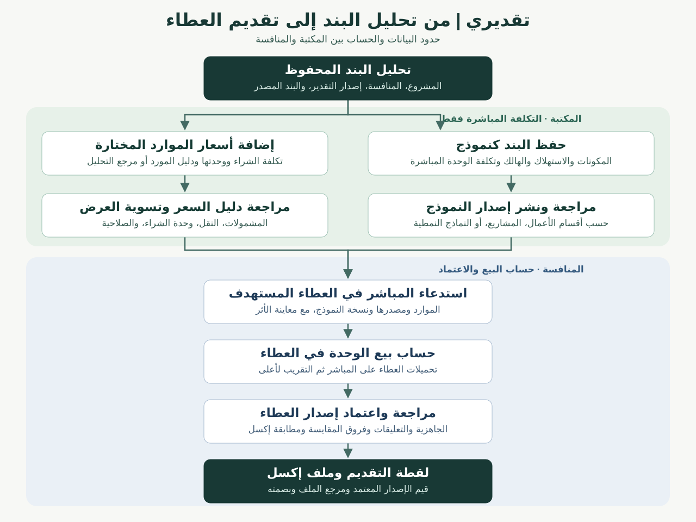

# تقديري | خطة تنفيذ مكتبات التسعير ومراجعة العطاء

**مراجعة تصميم للتنفيذ.** أول تسليم يستخدمه المسعّر يبدأ من تحليل محفوظ. يستطيع حفظ البند كنموذج، أو تحديد بعض موارده وإضافتها إلى مكتبة الأسعار، ثم استدعاء الناتج في منافسة ثانية ومعرفة مصدره. يبدأ النشر المشترك باعتماد نسخة النموذج أو دليل السعر. يبدأ تقديم العطاء باعتماد إصدار التقدير وملف التسليم المرتبط به.

## أساس تسعير المكتبة — التكلفة المباشرة فقط

كل سعر جاهز وكل إصدار نموذج، بما فيه النموذج المركب ومكوناته الفرعية، يُحفظ ويُعرض ويُستدعى بتكلفة الوحدة المباشرة وبدقتها الأصلية. تُطبّق نسب غير المباشر والمصاريف العامة والمخاطر والربح مرة واحدة في إصدار تقدير المنافسة، ثم يُقرّب سعر بيع الوحدة لأعلى. نسبة الهالك الفعلي تدخل في كمية المورد، ومعدل الإنتاجية يدخل في ساعات العمل. يحتفظ عرض المورد بسعر الشراء وشروطه الأصلية كدليل.

**عقد الحفظ.** يفرض الخادم أساس `direct_cost` على الإنشاء والاستيراد والنسخ والحفظ من تحليل. يقبل سعر شراء المورد أو المباشر المشتق من المكونات، ويرفض حقول تحميل المنافسة وسعر البيع في بيانات النموذج القابلة للاستدعاء. عند الرجوع إلى تحليل مُسعّر، يقرأ المباشر قبل التحميل والتقريب من المصدر. السعر اليدوي أو القديم الذي لا يُعرف أساسه يبقى «يحتاج مراجعة» خارج الاستدعاء حتى يتوفر تحليل مباشر أو مستند شراء. تبقى تحميلات العطاء السابق في سجله التاريخي.

**اختبار القبول.** مباشر وحدة 100.25 ريال بهالكه المحسوب، وبيعها في العطاء الأول بعد تحميل 20% وتقريب الوحدة يساوي 121 ريالاً. عند حفظها كنموذج ونسخها وإدراجها داخل نموذج مركب بمعامل 1 يكون المباشر في كل خطوة 100.25. عند استدعائها لعطاء ثانٍ بتحميل 10% يصبح بيع الوحدة 111 ريالاً. إعادة حفظ التحليل في المكتبة تعيد 100.25. يختبر الفريق أيضاً رفض استيراد 121 كسعر مباشر إذا كان مصدره حقل البيع.

| قيمة مالية | موضعها ومصدرها |
|---|---|
| تكلفة شراء المورد | سطر العرض الأصلي ومستنده. تُحسب قيمة الشراء القابلة للاستخدام مع عوامل التحويل والنقل والضريبة والعملة وفق شروط العرض وسياسة المشروع. تُحتسب الضريبة القابلة للاسترداد في موضعها المالي وفق تلك السياسة |
| مباشر النموذج أو الحزمة | تكلفة الموارد أو الحزمة على وحدة قياس صريحة، مع إصدار المدخلات. يحمل النموذج المركب كميات ونطاقات ومصادر مكوناته وتكلفتها المباشرة |
| سعر بيع المنافسة | مباشر الوحدة مضافاً إليه قيم التحميل المستقلة ثم ROUNDUP. النسب من سياسة إصدار المنافسة المستهدفة. قرار تجاوز سعر البيع يظل ضمن هذا الإصدار |

**أولوية التوافق مع القائم.** تقرأ `calculateBreakdownCost` اليوم حقول `recommended_*_pct`، ويكتب `applyTemplateToBoqItem` النسب الناتجة في `price_analysis_markup` عند الاستدعاء. وتعرض شاشة المكتبة معاينة لسعر البيع. قبل فتح المكتبة الجديدة، يعدّل الفريق هذه المسارات معاً. عرض المكتبة يقرأ المباشر، والاستدعاء يأخذ الموارد والمباشر ويحتفظ بنسب البند المستهدف. يستخدم البند الجديد إعدادات المنافسة، ويطلب النظام تحديدها إذا غابت. تُفحص القوالب المدمجة والمخصصة والاستيراد الجماعي ونسخ النموذج ومسارات استدعاء النموذج من الصفحة ومن داخل البند. يُستخرج المباشر من سطور الموارد المعروفة وتُصان القيم القديمة في سجل الترحيل.

## أساس القرار وما يُبنى عليه

الملاحظتان اليدويتان تحددان الأفعال ومكانها والأقسام التي يراها المستخدم. خطة المكتبات تترجم ذلك إلى M-01…M-05 ومسار أول مقدّر بعشرة أسابيع. خطة V3 تضيف الجاهزية والتعليقات وتسوية العروض وفروق المقايسات واعتماد التقديم ضمن برنامج مقدّر بسبعة عشر أسبوعاً. نعتمد نطاق V3 ونقدّم أول تجربة مكتبية في ترتيب التسليم. المساران يشتركان في التأسيس والاختبارات. لا تُجمع المدتان.

| نقطة الدمج في المستودع | قرار التنفيذ |
|---|---|
| `src/routes/_authenticated/price-analysis.tsx` و`components/price-analysis/in-place-template-caller.tsx` تحت src | وضع الإجراءين بجوار التحليل المحفوظ، وتوسيع منتقي النماذج داخل البند بنفس شجرة المكتبة |
| `src/routes/_authenticated/item-breakdown-library.tsx` و`src/lib/breakdown-library.ts` | إعادة استخدام محرر النموذج ووضعَي Edit وDuplicate. تعديل نموذج منشور يفتح مسودة إصدار تابع. النسخ يولد هوية نموذج جديدة |
| `src/components/price-analysis/select-quote-dialog.tsx` و`src/lib/csi-assemblies-engine.ts` | توسيع اختيار العرض والتحويل والتدقيق الموجود، مع تتبع مصدر السعر عند النسخ في الاتجاهين |
| `src/components/layout/app-shell.tsx` وقواميس اللغات | تعريف شجرة تصفح واحدة للقائمة والصفحة ومنتقي البند، مع اتجاه عربي يمين وإنجليزي يسار. الضغط على العنوان يفتح الصفحة والسهم يوسّع الفروع |
| `src/lib/estimation-calc.ts` و`src/lib/client-tender-service.ts` وترحيلات Supabase | تثبيت عقد حساب واحد، وتوسيع عملية تقديم العطاء القائمة لتربط قرار المراجعة والملف واللقطة بإصدار التقدير ذاته |

**حسم اختلاف المرفقات.** نعتمد قاعدة التكلفة المباشرة عند اختبار مطابقة النموذج مع تحليل المصدر، ونستخدم بيع المصدر فقط في مصالحة سجل العطاء. ترتيب V3 يضع الجاهزية مبكراً، وخطة المكتبات تبدأ بالحفظ والاستدعاء. نبدأ بالحفظ والاستدعاء والتصفح بعد إصلاح أساس السعر، ونعتمد عقد إصدار التقدير مبكراً حتى تعمل عليه الجاهزية والتقديم من دون إعادة تصميم البيانات.

## تجربة المسعّر وتنظيم المكتبتين

1. **حفظ التحليل كنموذج.** يختار المستخدم الوجهة والاسم والتصنيف والوحدة. تعرض المعاينة المشروع والمالك والمنافسة والإصدار والبند والافتراضات والمشمولات والاستثناءات. تحفظ معاملات الاستهلاك والهالك والإنتاجية على أساس وحدة البند. تُحفظ كمية المشروع وتحميلاته في سجل المصدر لإعادة الحساب التاريخي. عند الاستدعاء تؤخذ الكمية والتحميلات من المنافسة المستهدفة. الوجهة الافتراضية مكتبة المشروع، والترقية إلى مكتبة الشركة تتم بعد مراجعة.
2. **إضافة موارد إلى مكتبة الأسعار.** يحدد المستخدم سطراً أو عدة سطور أو الكل، وتعرض المعاينة نوع كل مورد ووحدة شرائه وتكلفة شرائه المباشرة وتاريخها وأصل الرقم. إذا كان الدليل عرضاً موثقاً يُربط بسطره وإصداره. السعر الذي أدخله المسعّر يُسجل «مرجع داخلي من تحليل» ويظهر في تبويب مستقل. يبقى معامل استهلاك الخرسانة أو ساعات الطاقم مرتبطاً بطريقة تنفيذ البند، ويظهر كاقتراح قابل للتعديل عند الاستدعاء.
3. **داخل المكتبة وداخل البند.** نماذج البنود لها «عام»، «حسب أقسام CSI»، «حسب المشاريع»، «التكلفة غير المباشرة»، «نماذج تسعير نمطية». عروض الأسعار لها «عام»، «عروض الأسعار» بتبويبي الموردين والأدلة المرجعية، «حسب المشروع»، «عروض النماذج النمطية» مثل تسوير Plywood ولافتات المشروع. تصنيف الموارد مرشح مستقل يشمل المواد وإكسسواراتها والعمالة والمعدات ومقاولي الباطن والمتطلبات العامة. تعرض شجرة المشروع الشركة ثم المالك ثم المشروع ثم المنافسة والإصدار. كل طرق العرض تقرأ نفس السجل.
4. **الاستدعاء والمراجعة.** يرى المسعّر الإصدار وحالة السعر «حديث، قديم، مفقود» ومصدره ووحدته. تقادم السعر يضبط بحسب الفئة، وصلاحية عرض المورد تُقرأ من العرض. يستطيع اختيار مصدر أحدث ومعاينة فرق المباشر والبيع قبل الحفظ. تُنسخ السطور إلى مسودة المنافسة مع مرجع الإصدار. نشر إصدار أحدث يتيح المقارنة والتحديث الاختياري. تعرض المكتبة أسماء المشاريع والمستندات وفق صلاحيات قارئها.

## عقد البيانات والخدمات

**قرار التنفيذ.** تمتد الوحدات داخل تطبيق TanStack Start الحالي. تستخدم الواجهة خدمات الحفظ والاستدعاء والمراجعة، وتستدعي هذه الخدمات دوال الحساب المشتركة وتتحقق من صلاحيات البيانات على الخادم. تحفظ Supabase إصدارات السجلات وعلاقاتها، ويحتفظ التخزين الخاص بالمستندات الأصلية وملفات التسليم. تستخدم بطاقة النموذج وحساب المباشر في العطاء نفس منطق الكميات والتحويل. وحدها عملية تسعير إصدار المنافسة تجمع المباشر مع تحميلاته. تُعاد نتيجة الحفظ ومعها معرّف السجل ورقم الإصدار حتى تعرض الشاشة ما حُفظ فعلاً.

هذه أسماء منطقية لتصميم التوسعة. يطابق الفريق كل كيان بالجداول الموجودة في الترحيلات وبالمخطط الفعلي قبل إنشاء أي جدول. يبقى التطبيق على TanStack Start وعملاء Supabase الحاليين تحت التخطيط المصادق عليه.

| الوحدة | التفصيل المطلوب لكل سجل | عملية الخادم وضابطها |
|---|---|---|
| الشركة والمنافسة | علاقة الشركة بالمالك، المشروع، المنافسة، مراجعة BOQ، إصدار التقدير | يُتحقق من انتماء البند للإصدار والمنافسة والشركة على الخادم. صلاحيات القراءة والكتابة تشمل RLS والمستندات في Storage |
| نموذج المعرفة | هوية ثابتة، إصدارات، مكونات ومعاملات ووحدات، نطاق، مصادر، حالة اعتماد | اقتراح من تحليل محفوظ مع رقم إصداره المتوقع ومفتاح منع التكرار. الكتابة والرابط وسجل التدقيق في معاملة واحدة. عند التشابه يقترح النظام فتح القائم أو إصداراً أو نسخة |
| دليل السعر والعرض | مورد وفئة، مبلغ وعملة ووحدة شراء، ضريبة ونقل وحد أدنى ومنطقة وصلاحية، مصدر داخلي أو رقم عرض وسطر ومرفق | تحديد السطور ثم معاينة ثم ترحيل. يحتفظ الدليل بالإسناد التاريخي، وتُحجب تفاصيل العميل المحمية عند الترقية. العرض المركب يرتبط بإصدار النموذج وحدود معلماته |
| التعليق والجاهزية | التعليق وأهدافه والمسؤول والموعد والدليل والأثر وعملته، نتيجة فحص مرتبطة بإصدار المدخلات | مفتوح، جارٍ، بانتظار رد، تحت المراجعة، مغلق بدليل، أو مخاطرة مقبولة بتفويض أو ملغى بسبب. تُعاد المراجعة عند تغير الافتراض. التعليق الواحد على عدة بنود يُجمع مرة واحدة حسب توزيع أثره |
| مقارنة الموردين وفروق المقايسة | حزمة مقارنة بإصدار وعروض وتسويات، وزوج مراجعات BOQ وروابط المطابقة وقرارات المهندس | تحفظ التسويات ومصادرها واختيار المسعّر. تعتمد روابط البنود الملتبسة يدوياً قبل نقل أي تحليل |
| لقطة التقديم | إصدار التقدير وسياسة الحساب والجاهزية والتحفظات والاعتمادات، ومسار ملف التقديم وبصمته | يولّد الملف من الإصدار المحدد ويُتحقق منه، ثم تقفل المعاملة الإصدار وترفض فحصاً قديماً أو ملفاً لإصدار آخر. إعادة الطلب تُرجع نفس نتيجة التقديم |

### مفاتيح الربط ومصدر الحقيقة

- تُراجع ترحيلات `companies` و`company_client_links` و`tenders` قبل تحديد الربط النهائي. يعتمد العزل على الشركة والمشروع والمنافسة والصلاحية الممنوحة. تكرار المالك في شركتين حالة عادية. يُقيّد ربط بند أو عرض أو تعليق بحيث يصح انتماء كل المعرفات إلى نفس المسار المصرح، ويُفهرس البحث حسب الشركة والتصنيف وحالة النشر.
- يحدد `boq_excel_versions` المصنف المستلم. يحدد إصدار التقدير مراجعة المصنف التي يعمل عليها، ونسخة بيانات الأسعار التي راجعها الفريق. يُستخدم مفتاح بند مستقر حيث يتيحه المصدر. وتحفظ خريطة Excel الورقة والصف وخلايا الوحدة والكمية والسعر لكل مراجعة. هذا يتيح نقل تحليل بند انتقل مكانه وحجب النقل عند تغير معناه.
- تخزن النماذج المخصصة حالياً في إعدادات مساحة العمل، وتوجد قوالب مدمجة في المستودع. ينقل الترحيل كلاً منهما إلى إصدارات معلومة الهوية والمصدر. تتبع لقطة الاستخدام إصدار النموذج وسطر العرض وإصداره وتاريخ السعر، مع نسخ القيم المستخدمة فعلاً. تعديل النموذج المنشور يفتح إصداراً لاحقاً. الأرشفة توقف اقتراحه مستقبلاً وتبقيه قابلاً للتتبع.
- يُعاد استخدام `supplier_quotes` و`supplier_quote_items` لحفظ مستندات الشراء. يكون دليل سعر التحليل داخلياً وقابلًا للبحث بجانب العروض. نشر الدليل يحفظ المبلغ ووحدته وأساسه، وربط السطر بتحليل بند يحفظ معدل استهلاك هذا البند على حدة. مصدر الصلاحية للعروض الخارجية هو تاريخ العرض، وللمرجع الداخلي تاريخ السعر وحد التقادم للفئة.

### كتابة البيانات والاعتماد

1. **حفظ من التحليل.** ترسل الواجهة معرّف التحليل ورقم نسخته ومعرّفات السطور المختارة. يعيد الخادم قراءة السطور والتحقق من النطاق وإعادة اشتقاق المباشر. يسجل المصدر والنسخة والمسودة والتدقيق في كتابة متسقة، بمفتاح يمنع تكرار الطلب. نتيجة المعاينة السابقة تُلغى إذا تغيرت نسخة المصدر.
2. **استدعاء إلى بند.** يراجع المهندس فرق الموارد ووحداتها ونطاقها قبل اختيار الدمج أو الاستبدال. تحفظ العملية السطور والمرجع وتحديث حالة التسعير معاً، مع تحقق نسخة البند لالتقاط التحرير المتزامن. بعد نجاح الحفظ تُحدّث بطاقات البند والمقايسة والتقارير والجاهزية. اختبار التحليل الفارغ يثبت اختفاء سعر التحليل من المسودة بعد إعادة فتحها.
3. **تقديم العطاء.** يعتمد الخادم على مدخلات الإصدار المخزنة عند حساب الإجماليات. تُجهّز لقطة مرشحة وملف Excel خاص من المدخلات نفسها، ويُسجَّل رقم المراجعة وبصمة الملف ونتيجة المصالحة. عند التأكيد يتحقق الخادم من الصلاحية وسلامة الملف وثبات الإصدار ونتيجة الجاهزية، ثم يثبت اللقطة والحالة وسجل التدقيق في معاملة. الكتابة إلى Storage مرحلة تجهيز قابلة للاستئناف، ويصبح الملف مرئياً للجهات المصرحة عبر مرجع اللقطة بعد الاعتماد. إجراء التقديم الحالي يستقبل الإجماليات والسطور من العميل، لذا تدخل مراجعة هذه الثقة ضمن توسعة `submit_tender_version`.

يجهّز مهندس التسعير المسودة، ويراجع مهندس التخصص النطاق والمعاملات، وتتحقق المشتريات من مستندات المورد وشروطه، ويعتمد رئيس التسعير النشر المشترك، ويقبل مدير العطاء المخاطر المسموح بها ويوقع التقديم. يختبر الفريق الصلاحيات بحسابين من شركتين لهما نفس مالك المشروع. يسمح بالنموذج المنشور وفق نطاق المشاركة مع حماية اسم المشروع الأصلي وعرض مورده.

## المنهجية الحسابية وحالات الاختبار المرجعية

- **بيع الوحدة.** يُحسب المباشر من الموارد بوحدات متوافقة وهالك محسوب مرة واحدة. كل نسبة تحميل تعتمد على المباشر نفسه. يُطبّق ROUNDUP على بيع الوحدة إلى ريال صحيح قبل الضرب في الكمية. تُحفظ الدقة الداخلية والأساس والعملة. مثال V3 للسور يعطي 30,008 ريال مباشر لكل 100 م، أي 300.08 للمتر. مع تحميل 22% يصبح الخام 366.0976، والمعتمد **367 ريالاً/م، وإجمالي البيع 36,700**. افتراضات المثال للاختبار. تستقبل المكتبة 300.08 ريال/م. تُراجع مطابقة مبلغ البيع في سجل العطاء المصدر.
- **نموذج السور والخزان.** لسور بطول 100 م وارتفاع 3 م وفتحة 4 م وهالك ألواح 5% يكون طلب ألواح الوجه الواحد 302.4 م². تعرض البوابة والقوائم والنقل والتركيب والفك كبنود ذات نطاق صريح. للخزان الأرضي تُطلب السعة والأبعاد والسمكات المعتمدة وظروف الحفر والعزل والتسليح والاختبارات. غياب سماكة الجدار مثلاً يترك كمية خرسانته «تحتاج معلومة تصميم». صيغ النماذج مقيدة بالوحدات والمعاملات المسموحة، وتُرفض القسمة على صفر والاعتماد الدائري والقيم خارج مجال النموذج.
- **التكاليف غير المباشرة.** تُحفظ نماذج هذه الفئة بمكونات فعلية وأسعار موارد مباشرة، ويحدد العطاء طريقة توزيعها. تُحسب مصاريف التأسيس مرة واحدة، والموارد الزمنية من المعدل × العدد × المدة لكل فترة. مثال مشرفين لمدة 3 أشهر ثم مشرف لمدة شهر بسعر افتراضي 10,000 ريال للمشرف شهرياً يعطي 70,000. يحدد الفريق لكل عنصر مسار استرداد واحداً، كبند تمهيدي مستقل أو توزيع على بنود مؤهلة. يجب أن يتطابق مجموع التوزيع مع وعاء التكلفة، مع تسوية فرق التقريب ومنع إعادة تحميل المصروف ذاته ضمن نسبة المصاريف.
- **مقارنة عروض الخرسانة.** تُراجع المطابقة الفنية أولاً، ثم توحّد وحدة السعر وموقع التسليم والضخ وحد التشغيل والضريبة والعملة وتاريخ التحويل. توضح المقارنة السعر الأصلي وكل تسوية وأساسها. بند ضخ غير مؤكد لـ800 م³ بفرض 18 ريالاً/م³ يسجل تعرضاً مباشراً مقدراً بـ14,400 ريال. الأثر مجهول القيمة يسجل «غير مقدّر». أثر البيع النهائي هو فرق إجمالي السيناريوهين بعد تقريب سعر الوحدة لكل منهما.
- **فروق المقايسة.** تُحفظ نسختا Excel وبصمتهما. تبدأ المطابقة بكود موثوق وتسلسل القسم والوحدة ثم الوصف، ويظل رقم الصف مرجعاً للموضع. يلزم قرار مهندس عند الانقسام أو الدمج أو تغير الوحدة والنطاق. انتقال الكمية من 800 إلى 900 والسعر من 300 إلى 315 يعطي فرق كمية 30,000 وفرق سعر 13,500 على الكمية الجديدة، والمجموع **43,500**. تسجل الإضافات والحذف منفصلة. يقارن الاعتماد مجموع الفروق بفرق إجمالي النسختين.
- **الجاهزية.** تعرض النتائج بنداً غير مسعّر، عرضاً منتهياً، نطاقاً مزدوجاً، تعليقاً مفتوحاً، مطابقة معلقة أو اختلاف Excel. تعرض السبب والمالك والأثر والإجراء الذي يفتح البند. فرق الملف المالي والبنود الإلزامية غير المسعّرة يمنعان التقديم. العرض المنتهي يحتاج تجديداً أو قرار قبول مخوّل إذا سمحت سياسة المنافسة. يمكن عرض المرجع الداخلي المعتمد كملاحظة عند سماح السياسة باستخدامه. يبطل أي تعديل مؤثر صلاحية الفحص السابق، ويُثبت قبول التحفظ على الإصدار المعني مع السبب والموافق وتاريخ القرار.

## برنامج التنفيذ المقترح

التقدير يفترض توافر مطور واجهة ومطور بيانات/خادم ومختبر، مع مهندس تسعير وممثل مشتريات وصاحب قرار تجاري. يعاد تقديره بعد جرد البيئة والبيانات. يبدأ تجهيز المحتوى مبكراً، ويقاس بتغطية البنود الفعلية وقيمتها وحداثة دليل السعر.

| الفترة | حزمة العمل والمسؤول | ما يثبت اكتمالها |
|---|---|---|
| الأسبوعان 1–2 | جرد الجداول ومصادر التخزين ووجهة النشر والصلاحيات. يختار رئيس التسعير منافستين وعينات خرسانة وسور وخزان وملفاً له مراجعتان | خط أساس للكميات والأسعار والملفات، مصفوفة موجود/يمدد/جديد، استعادة مجربة، واعتماد سياسة التقريب والتقادم والنشر |
| 3–4 | نواة الإصدارات والإسناد وRLS والتدقيق مع ترحيلات SQL مراجعة وإعداد الاختبارات | تكرار أمر الحفظ ينتج سجلاً واحداً. تحرير متزامن يظهر تعارضاً. حساب الشركة الثانية يعجز عن قراءة المصدر الخاص |
| 5–6 | أول تسليم للمسعّر، DEV-301 إلى 304. الإجراءان من التحليل، والتصفح والاستدعاء بالعربية والإنجليزية | حفظ تحليل واستدعاؤه في منافسة ثانية مع الاحتفاظ بتحميلاتها. نموذج واحد يظهر حسب المشروع والقسم بعد اعتماده. السعر الداخلي يظهر في المراجع. الرفض يعيد المسودة بتعليق |
| 7–9 | الجاهزية والتعليقات DEV-307/308، وتسوية الموردين DEV-309 بالتوازي بعد ثبات عقد الأسعار | تعليق الضخ له مسؤول وأثر ودليل إغلاق. اختيار عرض شامل يمنع إضافة الضخ ثانية. نجاح اختبار عرضين مختلفي الوحدة والنطاق |
| 10–12 | فروق BOQ، DEV-310، واستكمال المحتوى وربط المراجعات بالنماذج | مطابقة فرق 43,500، ومراجعة التحويلات الملتبسة، وفتح البند من الجاهزية في الإصدار الصحيح |
| 13–15 | النماذج النمطية وغير المباشرة DEV-305/306 | إعادة حساب السور والخزان، وتغيير المدة وعدد الموظفين، ومطابقة وعاء التوزيع. معاينة الفرق بين عرض الحزمة وبناء سعر مكوناتها، واختيار أساس تسعير واحد |
| 16–17 | الاعتماد والتقديم DEV-311، قبول المستخدمين، وتجربة الرجوع | اعتماد منافسة تجريبية ومطابقة سعر كل سطر وإجمالي كل عملة في Excel مع اللقطة. تغيير أسعار المكتبة لاحقاً يترك الملف المقدم وبصمته ثابتين |

### مصفوفة القبول قبل فتح الميزات

تعتمد الحزم على ثلاثة قرارات متتابعة. يثبت مهندس التسعير أساس الوحدة والنطاق قبل اعتماد النموذج، وتثبت المشتريات أساس الشراء قبل اعتماد تسوية العرض، ويثبت مدير العطاء نسخة المقايسة ومطابقة ملف التسليم قبل التقديم.

| متطلبات المرفقات | تجربة القبول التي ينفذها المستخدم |
|---|---|
| M-01 وDEV-301 | حفظ تحليل عمود مكتمل ثم فتح إصدار النموذج من المشروع المصدر. تطابق تكلفة الوحدة المباشرة مجموع سطور الموارد بعد التحويل |
| M-02 وDEV-302 | تحديد سطري خرسانة وضخ فقط، ثم إعادة الطلب بعد انقطاع الاتصال. يظهر دليل واحد لكل سطر مختار مع التصنيف والوحدة والمصدر |
| M-03 وM-04 وDEV-303 | تصفية النماذج بنفس القسم أو المشروع في الشريط الجانبي وداخل البند. تتطابق المعرّفات والعدد ضمن صلاحية المستخدم عند تبديل لغة الواجهة |
| M-05 وDEV-304 | الوصول إلى نفس عرض التسوير من صفحة المشروع ومن عروض النماذج النمطية، وفتح نفس المستند والإصدار |
| DEV-305 وDEV-306 | تجربة السور والخزان والتوزيع الزمني الواردة في المنهجية الحسابية. يوقّع مهندس التخصص على أساس الكمية ويصالح رئيس التسعير مجموع التوزيع |
| DEV-307 وDEV-308 | تعليق حزمة بها عدة بنود ثم حل سببها وإعادة فحص الجاهزية. يظهر أثر الحزمة مرة واحدة ويتتبع المدير القرار إلى مستنده |
| DEV-309 وDEV-310 | اختيار عرض مكافئ النطاق ثم استقبال مراجعة مقايسة جديدة. يحسب المهندس أثر السعر وأثر الكمية ويوافق على المطابقات التي تغير نطاقها |
| DEV-311 | استخراج ملف التقديم من الإصدار المفحوص، وفتح النسخة المعتمدة من جلسة ثانية بعد تغيير سعر مورد في مسودة لاحقة، ثم مقارنة البصمة والمبالغ |

| الاختبار | صاحب التحقق | نتيجة القبول |
|---|---|---|
| أساس السعر عبر مسارات المكتبة | مهندس التسعير والمختبر | المسودة والنسخ والاستيراد والمركب تعرض 100.25 في اختبار المباشر. استدعاء القالب إلى بند عليه نسب قائمة يحتفظ بها. سطر مجهول الأساس يظهر للمراجعة |
| مقارنة عروض الحزم | المشتريات ومهندس التخصص | عرض توريد مع ضخ وعرض توريد فقط يتساويان في النطاق بعد التسوية. المهندس يستطيع تفسير كل فرق. الحد الأدنى يدخل مرة واحدة |
| عزل البيانات وثبات النسخ | مسؤول البيانات | شركتان لهما نفس المالك. يفشل الطلب المتقاطع من الواجهة ومن واجهة البيانات. يظل المستند الخاص محمياً. نجاح طلب مكرر ينتج إصداراً واحداً |
| فروق المقايسة | مهندس الحصر | تحريك الصف مع ثبات البند يحتفظ بالتحليل بعد المطابقة. تغيير الوحدة أو تقسيم بند ينتظر القرار. فرق النسختين يساوي مجموع الفروق المعتمدة |
| التقديم وإعادة المحاولة | مدير العطاء ومسؤول الإصدار | عطل بعد تجهيز الملف يتيح استكمال الطلب نفسه. تغير السعر بعد فحص الجاهزية يبطل الفحص السابق. ملف Excel يطابق سعر كل سطر والإجمالي قبل الضريبة وبعدها وفق سياسة العطاء |
| توافق المسارات القائمة | المختبر ومسؤول الإصدار | تُفتح مشاريع سابقة وتُصدّر بالمصنف الأصلي بعد الترحيل التجريبي. تُقارن عينة من الأسعار والإجماليات قبل التحويل وبعده، وتوثق مسبقاً أي فروق ناتجة عن إصلاح تحميلات القوالب |

## الترحيل والتشغيل

يتدرج التنفيذ بإضافة الحقول والجداول ثم نسخ البيانات التاريخية على دفعات قابلة للاستئناف. تُحفظ المعرفات والمصادر الأصلية، ويوسم الدليل المفقود «يحتاج مراجعة». يقارن الفريق العدّ والروابط والمباشر والبيع لكل منافسة قبل تحويل القراءة. تنشر كل وحدة خلف إعداد تفعيل لشركة تجريبية، بدءاً بمكتبة المشروع. عند التراجع تُعاد القراءة إلى الإصدار السابق المتوافق وتُحفظ عمليات الحفظ الجديدة للمصالحة. تُختبر استعادة قاعدة البيانات والملفات معاً قبل الإطلاق.

**محضر القبول النهائي.** يسلّم مسؤول البيانات تقرير الترحيل والعزل والاسترجاع. تسلّم المشتريات مقارنة موقعة مع مصادرها. يسلّم رئيس التسعير نتائج حالات السور والخزان والتوزيع وفروق المقايسة، ومدير العطاء يعتمد ملف Excel ولقطته بعد إقفال الموانع. يختبر مستخدم آخر استدعاء المعرفة في منافسة جديدة، ويظهر له المشروع المصدر بالقدر المسموح مع تاريخ السعر وإصدار النموذج المستخدم.
